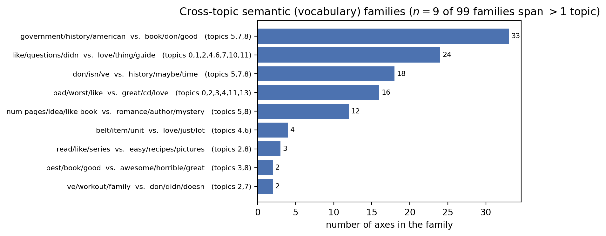

# TOPol — Reconstructing and Interpreting Multidimensional Semantic Polarity Fields

NLP usually treats polarity as one axis: sentiment. TOPol asks a different question: **within a topic, what are the documents bipolar *about*?** You don't name the answer in advance.

TOPol does not start from a named concept and look for its direction. It works the other way round. For each topic it finds **every statistically reproducible bipolar axis** that the topic's documents support in a transformer's residual stream. Only after that does it ask which of those axes match a known construct, if any. An axis does not have to be evaluative. Its two poles can contrast subject matter, register, or which of two product groups a review is about, as easily as *good vs. bad*.

This repository holds the code, notebooks and result tables for the mechanistic, residual-stream version of TOPol.

> **Not the same as [GabinTB/TOPol](https://github.com/GabinTB/TOPol).** That repository holds an earlier TOPol implementation that uses a fundamentally different method. Both share the name and the research question, but they answer different needs, and neither replaces the other.

---

## Headline results (Amazon reviews, Gemma 3 4B)

| | |
|---|---|
| Corpus | 9,986 balanced Amazon reviews (≤2★ vs ≥4★), segmented into **14 topics** |
| Axes that pass the split-half stability gate | **543** (33–45 mutually orthogonal axes per topic) |
| Sentiment re-derived blindly | in **every** topic (cosine 0.71–0.97 to the star-rating vector); discovery never sees the rating label |
| "Excess" axes | **106** stable axes that are near-orthogonal to sentiment |
| Depth signature | sentiment axes resolve in **later layers** than the other axes |
| Semantic families | **99** vocabulary families, **9** of which recur across topics |
| Does direction alone predict meaning? | only weakly: r = 0.243 pooled (p = 9×10⁻⁹), and anywhere from 0.69 to −0.36 across topics |

<p align="center">
  
</p>

---

## The method in one picture

```
 reviews ──► EmbeddingGemma-300m ──► UMAP + Leiden ──► topic labels (labels only)
    │
    └──────► Gemma 3 4B (-pt) residual stream, every layer, mean-pooled (BOS/special tokens excluded)
                  │
                  ├─ RULER:  v_CB^t  = per-topic diff-in-means of the star-rating boundary
                  │
                  └─ OBJECT: per topic, per layer
                        recursive bipartition (centred cosine 2-means → deflate → repeat)
                        → cross-layer dedup (ARI) → depth profile
                        → split-half stability gate (|cos| ≥ 0.6)  ⇒  gate-passing axes
                                       │
        ┌──────────────────────────────┼─────────────────────────────────┐
   identification & excess        interpretation                  causal ablation
   (axis vs. v_CB^t)         TF-IDF vocab · NLA decoder ·      remove sentiment directions,
                             LLM glosses (pt / it) ·           see what survives
                             semantic families ·
                             RoBERTa sentiment alignment
```

- **The ruler.** A topic's star-rating diff-in-means vector, `v_CB^t`, is sentiment by construction. TOPol uses it to calibrate discovery, not as its target.
- **The object.** A recursive, orthogonal-by-construction bipartition of each topic's document cloud. Every candidate axis counts as a finding only if it survives one split-half stability gate that is fixed before the analysis is run.
- **Three independent readings of meaning.** (1) differential TF-IDF vocabulary per pole, (2) a natural-language autoencoder (NLA) decoder trained on the same activations, (3) clustering by shared vocabulary across all 543 axes. On a hand-checked sample, the three agree.
- **One open model.** Everything that touches meaning runs on **Gemma 3 4B**. No proprietary APIs are used. The field is computed on `-pt`. `-it` is used only for one optional gloss step.

---

## Repository layout

```
topolm/            the library: config, data loading, backends, discovery, gate, field, NLA, ...
  backends/        GemmaBackend (real runs) · SyntheticBackend (offline dev/testing)
scripts/           the numbered CLI pipeline, steps 00–17 (run in order)
notebooks/         pipeline_2.ipynb · pipeline_2_part2.ipynb · causal.ipynb (executed, outputs kept)
results/           tables + JSON summaries from the reference run (amazon_reviews_pipeline_2)
docs/figures/      figures used in this README
```

### Key modules

| Module | Role |
|---|---|
| `config.py` | Central configuration, serialised as dataclasses. Every run writes its config to its manifest. |
| `data.py` | Corpus loaders and the contextual-boundary (CB) rule |
| `representations.py`, `topol_activations.py` | All-layer residual extraction; mean-pooled activation cache |
| `layer_select.py` | Picks the reference layer by A/B linear-probe separability |
| `manifold.py` | UMAP + Leiden topic segmentation (used only for clustering and 2-D display) |
| `field.py` | CB diff-in-means field; cross-topic pooled assembly; rank estimate |
| `topol_axes.py` | Per-topic, per-layer recursive bipartition, deflation, cross-layer dedup, depth profiles |
| `topol_gate.py` | Split-half stability gate and nuisance diagnostics |
| `topol_report.py` | Per-axis report (the most extreme texts on each pole) and a log of rejected axes |
| `pole_vocab.py`, `axis_semantics.py` | Differential TF-IDF per topic; meaning-based family clustering |
| `nla.py` | Natural-language autoencoder and activation-reconstruction interrogation (CPU only) |
| `pole_llm.py` | Gemma glosses of each axis (`-pt` completion route, `-it` instruction route) |
| `pole_sentiment.py` | Independent RoBERTa sentiment scoring and per-axis alignment |
| `causal_ablation.py` | Projects out sentiment directions and runs the before/after tests |
| `viz.py` | Every plot |

---

## Pipeline steps

Each script resumes the most recent run (`runs/LATEST`) unless you pass `--run-dir`. Every step writes its tables, objects and figures into the run directory and records them in `manifest.json`.

### Part 1: baseline field and axis discovery (`notebooks/pipeline_2.ipynb`)

| Step | Script | What it does | GPU |
|---|---|---|---|
| 00 | `00_prepare_data.py` | Builds the corpus and its contextual boundary (Amazon: ≤2★ vs ≥4★, 3★ dropped, 5k per class) | – |
| 01 | `01_extract_representations.py` | Embeds the corpus twice: EmbeddingGemma for segmentation, Gemma 3 4B residuals for the field | ✓ |
| 02 | `02_select_layer.py` | Picks the residual layer by A/B probe separability | – |
| 03 | `03_cluster_manifold.py` | UMAP + Leiden topic segmentation | – |
| 04 | `04_reconstruct_field.py` | CB polarity field (diff-in-means + probe directions) in the full space | – |
| 05 | `05_topol_cache_activations.py` | Caches mean-pooled activations at every `layer_stride`-th layer | ✓ |
| 06 | `06_topol_discovery.py` | Per-topic recursive bipartition, plus the split-half gate | – |
| 07 | `07_topol_field_assembly.py` | Cross-topic pooled field at the reference layer: participation ratio, spectrum, geometric families | – |
| 08 | `08_topol_baseline_compare.py` | Identification of `v_CB^t`, sentiment alignment, excess structure, final report | – |

### Part 2: what the axes mean (`notebooks/pipeline_2_part2.ipynb`)

| Step | Script | What it does | GPU |
|---|---|---|---|
| 09 | `09_pole_tfidf_wordclouds.py` | Exports per-axis texts, computes differential TF-IDF per topic, draws word clouds | – |
| 10 | `10_pole_llm_explanations.py` | Gemma 3 4B `-pt` grounded-completion gloss of each axis | ✓ |
| 11 | `11_topic_fields.py` | The polar field of each topic, plotted on its own | – |
| 12 | `12_pole_sentiment_alignment.py` | RoBERTa sentiment per document; tests whether `|cos(axis, v_CB)|` predicts sentiment | (✓) |
| 13 | `13_nla_axis_interrogation.py` | NLA/AR decoder: a prototype for each pole, plus an A→B sweep for every axis | – |
| 14 | `14_semantic_family_clustering.py` | Groups axes into families by shared vocabulary (meaning, not direction) | – |
| 15 | `15_pole_llm_it_explanations.py` | Gemma 3 4B `-it` instruction-route glosses, to compare against `-pt` | ✓ |

### Part 3: causal ablation (`notebooks/causal.ipynb`)

| Step | Script | What it does | GPU |
|---|---|---|---|
| 16 | `16_causal_direction_selection.py` | Finds the sentiment directions in each topic (`v_CB^t` plus axes that RoBERTa flags) and projects them out | – |
| 17 | `17_causal_ablation_analysis.py` | Before/after tests: probe necessity vs. a random control, `v_CB` magnitude, how much the excess axes retain, UMAP re-clustering | – |

> A step 18 (`causal_interpretation`: does an axis's *meaning* survive ablation, not just its effect size?) is in progress. It will be added once its module is ready.

---

## Installation

Python ≥ 3.10.

```bash
git clone https://github.com/gomez-L/TOPol.git
cd TOPol
python -m venv .venv && source .venv/bin/activate
pip install -r requirements.txt
```

The Gemma weights are gated on Hugging Face. Accept the licence for `google/gemma-3-4b-pt` (and for `google/gemma-3-4b-it` if you run step 15) and `google/embeddinggemma-300m`. Then run `huggingface-cli login`.

## Quick start

**Offline smoke test.** Synthetic backend with planted regimes. No GPU, no downloads, runs all of Part 1 in a few minutes:

```bash
python scripts/01_extract_representations.py --dataset synthetic_kd
for s in 02_select_layer 03_cluster_manifold 04_reconstruct_field \
         05_topol_cache_activations 06_topol_discovery \
         07_topol_field_assembly 08_topol_baseline_compare; do
  python scripts/$s.py --dataset synthetic_kd
done
```

**Full Amazon run:**

```bash
# put the review table at ./data/amazon_reviews_full.pkl
# needed columns: text (or review_body / content) + rating (or stars / overall / label)
python scripts/00_prepare_data.py              --dataset amazon_reviews --data-dir data
python scripts/01_extract_representations.py  --dataset amazon_reviews --backend gemma --data-dir data
python scripts/02_select_layer.py
python scripts/03_cluster_manifold.py
python scripts/04_reconstruct_field.py
python scripts/05_topol_cache_activations.py
python scripts/06_topol_discovery.py           # --stability-threshold 0.6 --max-depth 4 ...
python scripts/07_topol_field_assembly.py
python scripts/08_topol_baseline_compare.py
# Part 2 and Part 3: run 09 → 17 in the same order
```

Every script has a `--help` flag. You can override hyperparameters from the CLI, or with `--config path/to/config.json`. All defaults live in [`topolm/config.py`](topolm/config.py).

Main discovery defaults (`DiscoveryConfig`): `layer_stride=2`, `max_depth=4`, `min_cluster_size=30`, `ari_merge=0.7`, `stability_threshold=0.6`, `excess_cos_threshold=0.3`.

---

## Reference results

[`results/amazon_reviews_pipeline_2/`](results/amazon_reviews_pipeline_2/) holds the outputs of the run reported in the paper:

- `config.json`, `manifest.json`: the exact configuration and the list of artifacts.
- `objects/*.json`: layer selection, field summary (`ref_layer=16`, `k=543`), baseline comparison, causal-ablation summaries, and the full per-axis report.
- `tables/*.csv`: per-axis summary, TF-IDF terms, NLA prototypes and sweeps, LLM glosses (`-pt` and `-it`), sentiment alignment, causal-ablation tables.

The cached activations (`*.npz`, ~1.8 GB) and the per-axis full-text export (`topol_pv_full_texts.csv`, 178 MB) are too large for git, so they are not included here.

---

## Citation

The paper is under review. Until it is published, please cite this repository:

```bibtex
@misc{topol2026,
  title  = {TOPol: Reconstructing and Interpreting Multidimensional Semantic Polarity Fields},
  author = {Gomez, Lucia},
  year   = {2026},
  howpublished = {\url{https://github.com/gomez-L/TOPol}}
}
```

## License

MIT. See [LICENSE](LICENSE). The Amazon review texts belong to their original public source. They are not part of this repository's contribution.
